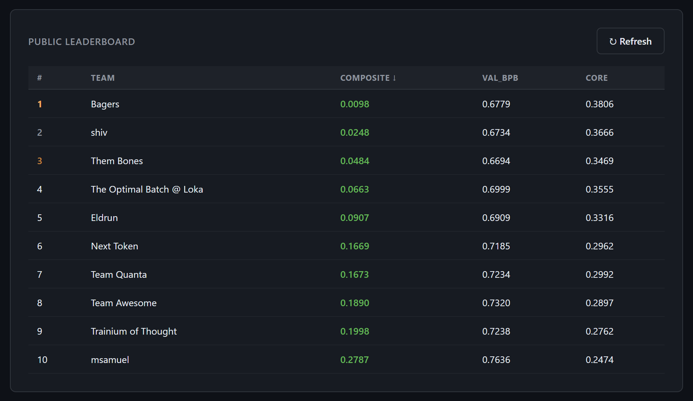
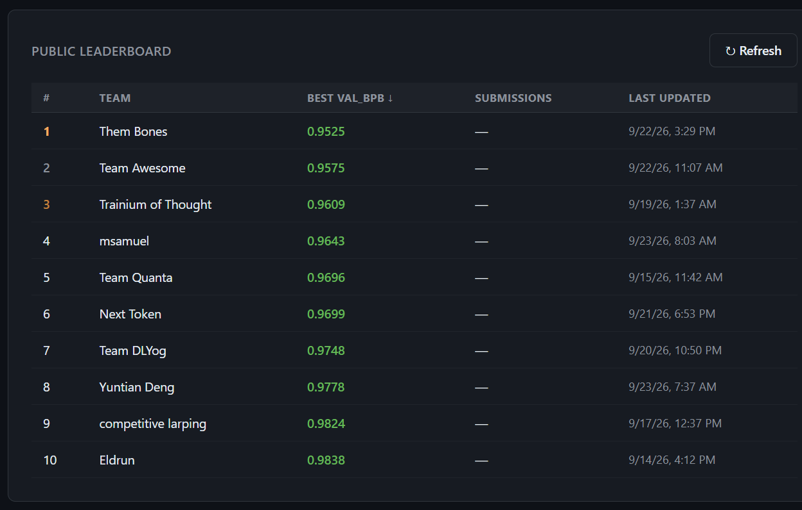

# Them Bones

**Training language models from scratch on AWS Trainium, against the clock.**

This is my entry to the AWS Trainium Frontier Competition, which ran from September to November 2026. The task: train a language model from random weights on Trainium2 chips inside a fixed time budget, then get scored on how good it is. Everything was open to change: the model, the optimizer, the data order, and the kernels that run on the chip.

It finished **3rd overall out of 100 teams**, and **1st in Round 1**.

| | Round 1 | Round 2 |
|---|---|---|
| Hardware | 1 Trainium2 chip (`trn2.3xlarge`) | 16 chips, 64 ranks (`trn2.48xlarge`) |
| Time budget | 30 minutes | 4 hours |
| Scored on | validation bits per byte (bpb) | bpb and CORE, a 22-task benchmark |
| Result | **0.9328 bpb, 1st** | **0.6694 bpb, 0.3469 CORE, 3rd** |
| Composite | | 0.0484 |
| Submission ID | `sub-3c799aa6` | `sub-52a8822e` |

Lower is better for bpb and the composite. Higher is better for CORE.

<p align="center">
  
  <br>
  <sub>The final Round 2 leaderboard.</sub>
</p>

The Round 2 model had the lowest validation loss of the ten finalists. It lost on CORE, and I'll get to why.

## Before you read the code

I'm a software engineer. Accelerator kernels were new to me this year: I wrote my first GPU kernel in March for an AMD contest, and NKI, the language Trainium kernels are written in, was new to me when this competition opened.

I also didn't do this alone. I worked with Claude as a coding agent the whole way through. I chose what to try, what to measure and what to keep, and it wrote a large share of the kernel code. Nothing went in on trust. Every kernel had to match the plain PyTorch result on the chip, and then show it was faster inside a real training run, because isolated benchmarks fooled me more than once.

So please don't read this as a reference implementation. It's the working record of about ten weeks of profiling, guessing, being wrong and measuring again.

## What's here

```
assets/                   the two leaderboard screenshots

round1/                   1 chip, 30 minutes
  submission/train.py     the exact file that was scored
  source/train.py         the same program in readable form, every kernel documented

round2/                   16 chips, 4 hours
  submission/             the exact files that were scored (train.py, inference.py)
  source/train.py         the working file, with every experiment switch still in it
  source/kernels/         the NKI kernel modules
  source/final_run.env    the switches that turn source/train.py into the final recipe
```

The files under `submission/` are byte for byte what the organizers ran. They look dense because uploads had a size limit, so the comments came out and the kernels were squeezed into one file. Read `source/` instead.

Each round has its own README with the model, the kernels and what actually moved the score:

- [Round 1: one chip, thirty minutes](round1/README.md)
- [Round 2: sixteen chips, four hours](round2/README.md)

## The short version

**Round 1 was a throughput contest.** With 30 minutes on one chip, a faster step means more training, and more training wins. The starter kit ran at about 42,000 tokens a second. The final file runs at about 340,000. Most of that came from fusing work into hand-built NKI kernels (attention, the loss, whole blocks of small elementwise ops) and from running the MLP matmuls in fp8. The single biggest gain wasn't a kernel at all, though. It was cutting the training text into windows the same way the scorer does.

<p align="center">
  
  <br>
  <sub>The Round 1 leaderboard on 23 September, a week before the close. The final score was 0.9328.</sub>
</p>

**Round 2 added a second score, and that changed everything.** bpb measures how well the model predicts text. CORE measures whether it can answer questions. I got very good at the first one. Two large tables, trained by gradient like any other weight, gave me the lowest bpb in the field, and almost none of that carried over to CORE. What did move CORE was less glamorous: a mixture-of-experts layer, and re-laying some of the provided training text into question-and-answer and input/output layouts, which the organizers ruled was allowed.

## What I'd do differently

- **Bet on a bigger dense model.** In mid-October my instinct said to go that way. I stayed with the tables because the loss was dropping faster. By the time it was clear that CORE wasn't following, a bigger model no longer fit in memory without work I had no time left for.
- **Trust single runs less.** I uploaded the exact same file four times and it scored between 0.332 and 0.347 CORE. I lost most of a week reading that kind of noise as progress.
- **Never trust a kernel benchmark on its own.** Three times a kernel looked great in isolation and then lost in the real training loop.

## Running it

You need the competition starter kit for `prepare.py`, the tokenizer and the data. The kit belongs to the organizers and isn't included here.

```bash
# Round 1, next to the kit's round1/prepare.py
NEURON_LOGICAL_NC_CONFIG=2 torchrun --standalone --nproc_per_node=4 train.py

# Round 2, next to the kit's round2/prepare.py
NEURON_LOGICAL_NC_CONFIG=2 torchrun --standalone --nproc_per_node=64 train.py
```

Software on the machines I trained on: neuronx-cc 2.26.6360.0, torch-neuronx 2.11.3, NKI 0.5.0, PyTorch 2.11.0, Ubuntu 24.04.

Round 2 keeps two large tables in host memory, more than 800 GB together, so it really does need the whole `trn2.48xlarge`.

## Weights and paper

The final Round 2 checkpoint is about 157 GB, most of it the two tables. Hosting is being sorted out with the organizers, and I'll link it here when it's up. A short paper with the ablations is coming in December.

## Thanks

Compute for this work was provided by AWS through the AWS Trainium Frontier Competition.

Thank you to the AWS Neuron and Annapurna Labs team for running it, and for answering far more rules questions from me than anyone should have to. Congratulations to Bagers and shiv, who finished ahead of me, and to everyone in the final ten. It was a hard field.

## License

Apache 2.0. The training scripts started from the competition starter kit, which is Apache 2.0 and copyright Amazon. See [NOTICE](NOTICE).
