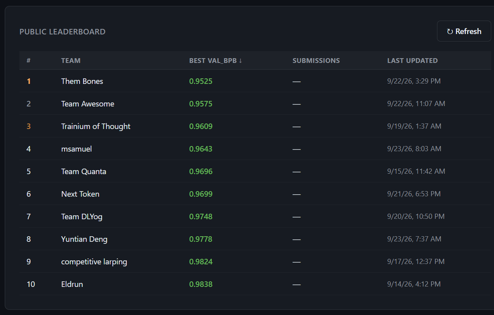

# Round 1: one chip, thirty minutes

**Result: 0.932751 validation bpb, 1st of 100 teams** (`sub-3c799aa6`). Second place was 0.9442.

<p align="center">
  
  <br>
  <sub>The leaderboard on 23 September, a week before the close. The score kept dropping from here to the final 0.9328.</sub>
</p>

The setup: one Trainium2 chip (`trn2.3xlarge`, 8 NeuronCores), a 30-minute training budget, and a GPT trained from random weights on the provided text. Compile time is free, only training time counts. The score is bits per byte on held-out text, lower is better.

## The model that won

- 12 layers, width 1024, about 196M parameters.
- Attention in 9 of the 12 blocks, with 6 heads of 128. The other 3 blocks swap attention for a much cheaper mixer that just looks one token back.
- ReLU² MLPs at ratio 6, RMSNorm, RoPE, QK-norm, and U-net style skip connections.
- Muon for the matrices, AdamW for everything else.
- bf16 throughout, with fp8 for the six MLP matmuls during training.
- 3,038 optimizer steps of 262,144 tokens inside the 30 minutes.

## Where the speed came from

The starter kit ran at about 42,000 tokens a second and used roughly 3% of what the chip can do. The final file runs at about 340,000 tokens a second, at roughly 43%.

- **A dtype slip in the baseline.** Two fp32 scalars were quietly promoting the whole residual stream to fp32. Casting them made every step 1.4x faster. Cheapest win of the contest.
- **Fusing the small stuff.** Profiling showed several hundred tiny elementwise ops, about 0.2 ms each, eating half of every step. A handful of NKI kernels took that away: RoPE with QK-norm, the block head, and later most of a block's elementwise tail in one "megablock" kernel.
- **Attention.** A flash-style attention kernel with its own backward. Later, RoPE and QK-norm moved inside it and get applied as the tiles load. With two related changes that was worth about 14% more training steps.
- **The loss head.** Softcap, log-softmax and cross-entropy in one launch each way. The step went from 1.37 s to 1.21 s.
- **fp8.** All six MLP matmuls run in fp8 during training. Each one bought 2 to 4% more steps, once the scales were right (see below, it took a while).
- **The optimizer.** Muon's orthogonalisation is split across the ranks, and AdamW and the gradient norm run as kernels too.

## The wins that weren't kernels

- **Window slicing.** The biggest single change of the whole round, worth 0.075 bpb. The kit started every training window at the start of a document, while the scorer's windows mostly start mid-document. Cutting each packed row into 8 windows fixed the mismatch.
- **Depth follows speed.** Deeper models kept losing at 30 minutes, until the step got fast enough. Depth 10 and then depth 12 only started winning after the throughput work. I closed that question as "no" four times before it flipped.
- **Predicting further ahead, for a while.** For the first half of the run the model is also asked for the tokens two and three ahead, faded out to zero by the halfway mark. The saved model is a plain next-token model.
- **Small things at the end.** Leaving end-of-document targets out of the loss late in the run, an fp32 master copy for Muon's updates, and blending the final weights slightly toward an earlier snapshot.

## What went wrong along the way

- **The fp8 clipping bug.** One activation scale was calibrated on a sample that under-read the real values by about 29x, so 3 of 10 layers were clipping. For days the fp8 forward pass looked like a dead end. It was a bug.
- **Training and evaluation disagreed.** fp8 training saturates one activation at 30,720, and the bf16 evaluation path didn't. Roughly one run in eleven was being scored as a slightly different model, until evaluation got the same clamp.
- **The matmul that was only fast alone.** A hand-built GEMM hit over 90% of peak in its benchmark and made real training 17% slower. The benchmark reused one input buffer. Real training doesn't, and with fresh buffers a transpose fell off the hardware path. One descriptor change fixed it.
- **A quiet mismatch in my own packaging.** For six candidates the submitted file ran one matmul in bf16 while my own runs used fp8, because of how the single file was assembled. Nothing crashed, it was just slower than it should have been. I only found it by running the submitted file itself.

## Finding the kernels in the source

`source/train.py` is one long file with the kernel modules inlined, each under a name prefix:

| Prefix | Kernel | Near line |
|---|---|---|
| `relu2k_` | ReLU² forward and backward | 519 |
| `gemmk_` | bf16 GEMM, and c_fc fused with ReLU² | 926 |
| `optk_` | AdamW and gradient norm | 1410 |
| `fp8k_`, `fp8nnk_`, `fp8tnk_` | the fp8 matmuls: forward, input gradient, weight gradient | 1949, 2509, 3077 |
| `ropek_` | RoPE with QK-norm (the fallback path) | 4308 |
| `lossk_` | loss head, single and multi-target | 4543 |
| `bheadk_` | block head: residual gains and RMSNorm | 5257 |
| `mblk_` | megablock: a block's elementwise tail | 5743 |
| `mixk_` | the one-token-shift mixer | 7097 |
| `attnk_` | attention forward and backward, RoPE inside | 7536 |
| `embk_` | embedding backward | 8303 |

Every kernel is a drop-in for the PyTorch expression it replaces, and keeps that expression as a fallback.

## Running it

Put `train.py` next to the starter kit's `round1/prepare.py` and run:

```bash
NEURON_LOGICAL_NC_CONFIG=2 torchrun --standalone --nproc_per_node=4 train.py
```

`submission/train.py` (md5 `bafc5d70f033ede4e54d3a3489e7bf0d`) is the scored file. `source/train.py` is the same program before it was squeezed to fit the upload size limit.
