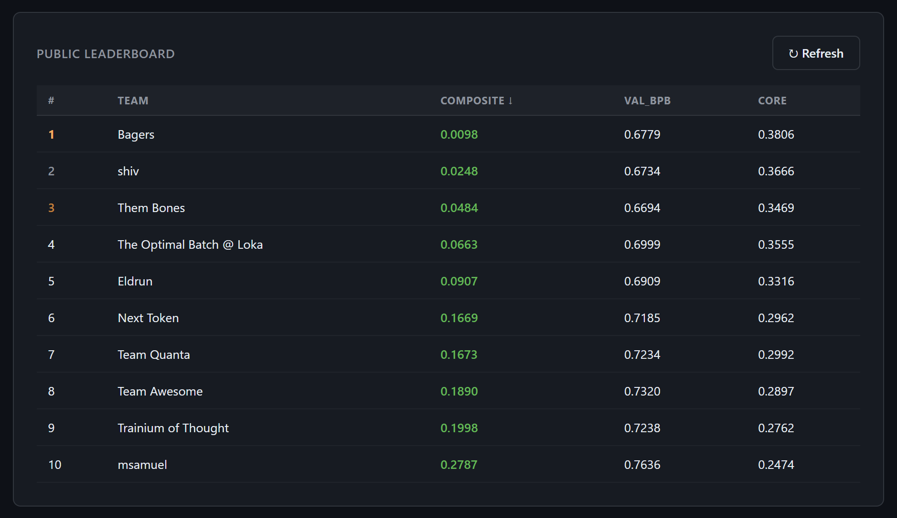

# Round 2: sixteen chips, four hours

**Result: 0.6694 bpb, 0.3469 CORE, composite 0.0484, 3rd place** (`sub-52a8822e`). The lowest bpb of the ten finalists.

<p align="center">
  
  <br>
  <sub>The final leaderboard.</sub>
</p>

The setup: one `trn2.48xlarge` (16 Trainium2 chips, 64 ranks), 4 hours of training, a bigger vocabulary (32,768), longer sequences (2,048) and the whole ClimbMix corpus. The score blends bpb with CORE, a 22-task benchmark the organizers run on your checkpoint.

## The model

- 18 layers, width 1536, 12 heads of 128.
- Five of the blocks (9, 11, 13, 15, 17) carry a mixture of experts: 64 experts, one living on each rank, and each token goes to one of them. That's 3.68B parameters in total, with about 0.71B active for any one token.
- Attention sees a 512-token band on 13 layers and the full 2,048 tokens on the other 5.
- Value embeddings on two layers, and U-net skips carried over from Round 1.
- Two big tables in host memory. Both start at zero and are trained only by the model's own loss gradient:
  - an **n-gram table** (2^30 rows): hashes of the last 2 and 3 tokens pick rows that get added to the input embedding;
  - an **output-side table** (2^32 rows): a hash of the last 16 tokens picks a row that nudges the output logits.
- Muon and AdamW, with the optimizer state split across the 64 ranks.

It trains about 15,000 steps of 1,048,576 tokens in the 4 hours, at 0.86 s a step. The kit's baseline, a 0.6B dense model, took 2.41 s for the same step.

## The kernels the final model runs

| Kernel | What it does | Where |
|---|---|---|
| Band attention | Causal attention, forward and backward, with RoPE and QK-norm done inside the kernel. One module runs both the 512-token band and the full-context layers. | `source/kernels/nki_attn_bandpro.py` |
| fp8 attention projections | The QKV and output projections in fp8, with weights cast ahead of time. | `source/kernels/nki_attn_tt8g.py` |
| fp8 MLP | The MLP forward and backward in fp8. The dense MLPs, the shared half of each expert block and every expert all go through it. | `source/kernels/nki_mlp_l4t.py` |
| fp8 weight gradients | The weight-gradient matmuls for the projections and the MLP. | `source/kernels/nki_dw8.py`, `nki_dw8w.py` |
| Loss head | The head matmul, the output-table read, the softcap and the cross-entropy, in vocabulary chunks. | `source/train.py`, `_lh_os1_fwd_kernel` near line 5881 |
| Embedding backward | The embedding gradient as a one-hot matmul on the chip. | `source/train.py`, `_eb_bwd_kernel` near line 5606 |

`source/kernels/` has 25 modules because I kept the earlier variants in the tree: the bf16 fused MLP, the first fp8 versions, and a few experiments that lost. The five named above are the ones `final_run.env` loads.

All the fp8 kernels accumulate in fp32 and round once at the end.

## What moved each score

Measured on my own machine, each step against the one before it, from the kit's baseline (0.797 bpb, 0.208 CORE) to the last step of that ladder (0.669 bpb, 0.344 CORE). Read it as a rough split, not exact science.

| What | bpb | CORE |
|---|---|---|
| Throughput: kernels, fp8, overlapping compute with communication | -0.035 | +0.037 |
| Recipe and shape: value embeddings, 18x1536, schedule, weight decay | -0.033 | +0.048 |
| The two tables | -0.049 | -0.012 |
| Mixture of experts | -0.009 | +0.011 |
| Re-laid text and data selection | -0.003 | +0.053 |

A few things behind that table:

- **Tables buy loss, not answers.** They were the single biggest bpb gain and they moved CORE the wrong way. They memorise how web text continues. That isn't the same as knowing things.
- **The bracket result.** One CORE task asks the model to close bracket sequences, and mine scored 0.10 on it. I cut bracket runs out of the provided documents and laid them out as input and output pairs under generic labels, which the organizers ruled was within the rules. That task went to 0.86. I wasn't the first to find this, and nothing else I tried responded like it.
- **Faster steps stopped paying.** By late October the chips were sitting at their power limit. Kernels that only removed waiting did nothing for a 4-hour run. Only doing less work per token still helped.

## What didn't work

- **A count-based memory.** It reached 0.58 bpb on my own machine. The organizers ruled, fairly, that a table filled by counting the data is stored data and not a model. Several days gone.
- **Bigger dense models.** 0.78B and 1B versions ran out of device memory at my batch size. I never did the work to make them fit, and I think that was the real mistake of the round.
- **A long list of smaller ideas.** A copy head, a ranking loss, full attention on every layer, heavier doses of re-laid text, more expert blocks. All of them lost on a full 4-hour run, usually after looking fine on a short one.

## Honest numbers

I uploaded the identical file four times. The leaderboard shows the best one.

| Run | bpb | CORE |
|---|---|---|
| `sub-52a8822e` (the leaderboard row) | 0.6694 | 0.3469 |
| `sub-20c02be8` | 0.6697 | 0.3396 |
| `sub-3ad64bca` | 0.6729 | 0.3320 |
| `sub-b5f8fb97` | 0.6691 | 0.3354 |
| Average | 0.6703 | 0.3385 |

So the honest CORE for this recipe is about 0.34, give or take 0.007.

## Running it

**The scored file.** Put `submission/train.py` and `submission/inference.py` next to the starter kit's `round2/prepare.py` and run:

```bash
NEURON_LOGICAL_NC_CONFIG=2 torchrun --standalone --nproc_per_node=64 train.py
```

`submission/train.py` has md5 `a88540c6781518dc7bbaa21c2c88eed5`. `inference.py` is the kit's reference wrapper, unchanged.

**The readable source.** `source/train.py` is the file I actually worked in. It still has every experiment switch, about 260 of them, most of them off. Export the values in `source/final_run.env` and it becomes the final recipe:

```bash
set -a; source final_run.env; set +a
NEURON_LOGICAL_NC_CONFIG=2 torchrun --standalone --nproc_per_node=64 train.py \
    --depth 18 --aspect-ratio 85 --device-batch-size 2 --max-train-seconds 14400
```

It isn't pretty. It's a lab notebook that happens to run. I checked the scored file against it at these switches on a small CPU run, and the losses and the checkpoint came out the same bit for bit. The 4-hour runs themselves were the organizers'.

The two tables need more than 800 GB of host memory, and the saved checkpoint is about 157 GB.
